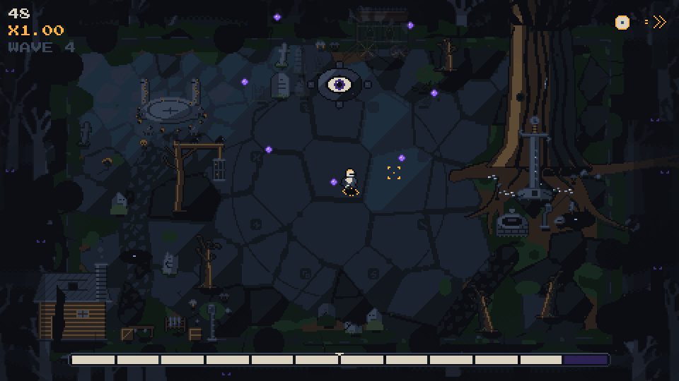
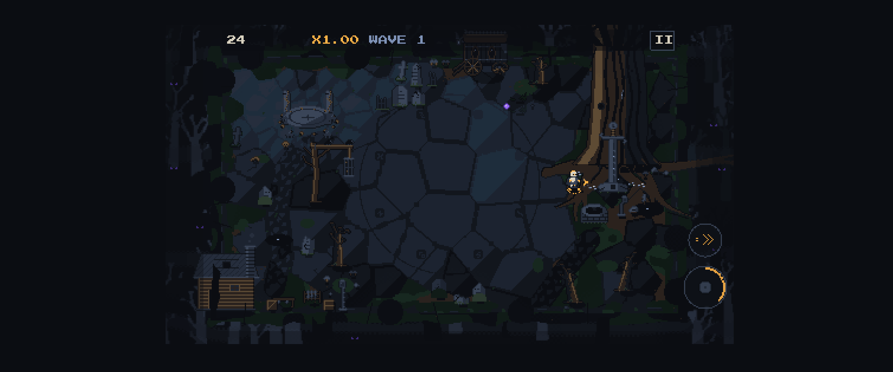

# Nightgrave

A dark-fantasy, single-arena dodge/parry survival game: endless waves, one hit = death, instant restart, score chase.
Two bosses (Eye Sentinel, Lich Mage), two pickups, three difficulties and an online Hard daily board.
Static HTML5 (TypeScript, Phaser 3, Vite). The title lives in one constant: `TITLE` in `src/config.ts` (rename there).





## Controls

- **Mouse**: the hero follows the cursor. Left click = parry, right click = dash.
- **Keyboard**: WASD / arrows move, J or Z = parry, K, Shift or Space = dash, Esc or P = pause.
- **Gamepad**: left stick moves, A = parry, B or RT = dash, Start = pause.
- **Touch** (landscape): drag anywhere to move a virtual cursor, PARRY button bottom right, DASH above it
  (mirrored with "Left-handed"), a second-finger tap also parries.

## Run it

```bash
npm install
npm run dev          # http://localhost:5173
npm test             # Vitest (sim, bosses, storage, touch, audio logic, shared code, Worker)
npm run build        # production build in dist/
npm run assets       # regenerate all art (Python 3 + Pillow + numpy) and run the art checks
npm run audio:check  # which audio files are present / missing
npm run smoke        # Playwright smoke test on a production build (phone + desktop)
```

## Audio

Put mp3 files in `assets/audio/` with the exact names from `AUDIO_LIST.md`, then run `npm run audio:check`.
Missing files fall back to synthesized sounds; nothing else to configure.

## Deploy

Cloudflare Pages (the game) + one Worker with D1 (the Hard daily board). Step by step: [DEPLOY.md](DEPLOY.md).
Without `VITE_API_BASE` the game runs fully offline.

## How scores are verified

Only runs proven by re-simulation appear on the Hard daily board. The game sends the score together with its input log
(compressed). The Worker checks plausibility and keeps the run as **pending**. Every 20 minutes a GitHub Action
(`npm run verify:pending`) re-runs the same deterministic simulation from the seed and the inputs and compares the
length and the score exactly; only a match is promoted to the board. A 10-minute run verifies in well under a second.

Remaining risks: a verified run can still come from an automated player (a bot that plays the real game); the daily
seed is a public hash of the date, so the next day's layout can be practised early. Proposed later fix: mix a server
secret into the seed and publish it at 00:00 UTC (offline Hard runs would then be unranked).

## Architecture

- `src/sim/` - pure deterministic simulation (60 Hz fixed step, seeded PRNG, replay = seed + difficulty + inputs).
- `src/render/` - Phaser scenes, menus, input (mouse/keyboard/gamepad/touch), audio; they only read sim state.
- `src/shared/` - pure code used by both the game and the server (daily seed, score bound, text rules, replay codec).
- `server/` - Cloudflare Worker + D1 for the Hard daily board (`server/migrations/`, `server/wrangler.toml`).
- `tools/` - deterministic Python art pipeline and checks; `tools/verify/` is the replay verifier (Node).

## Credits

- Font: Press Start 2P by CodeMan38, SIL Open Font License 1.1 (via `@fontsource/press-start-2p`).
- Art and code generated for this project. Engine: Phaser 3. Audio credits: to be added with the audio files.
