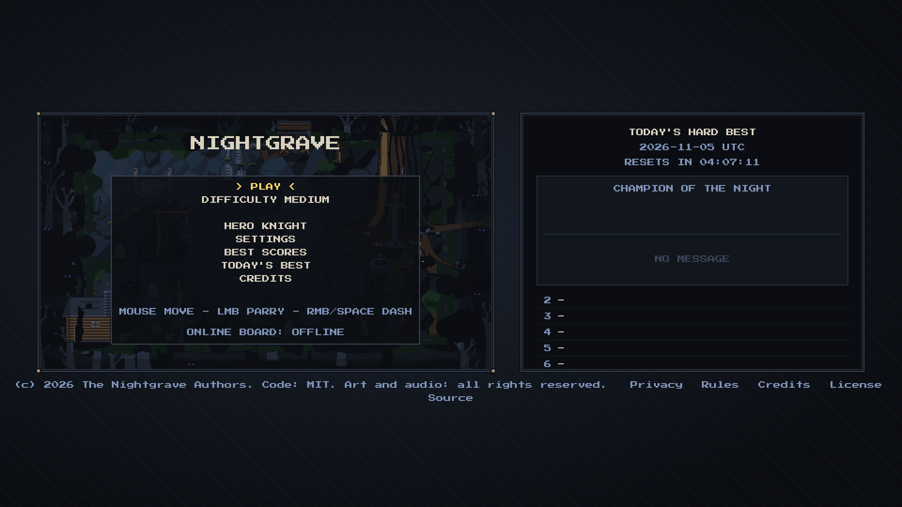
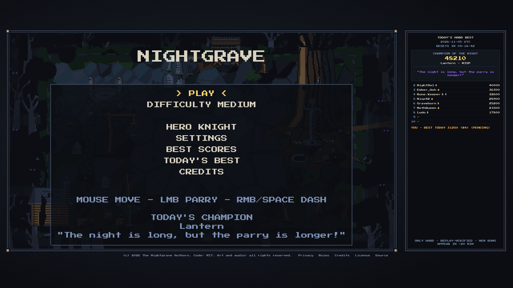
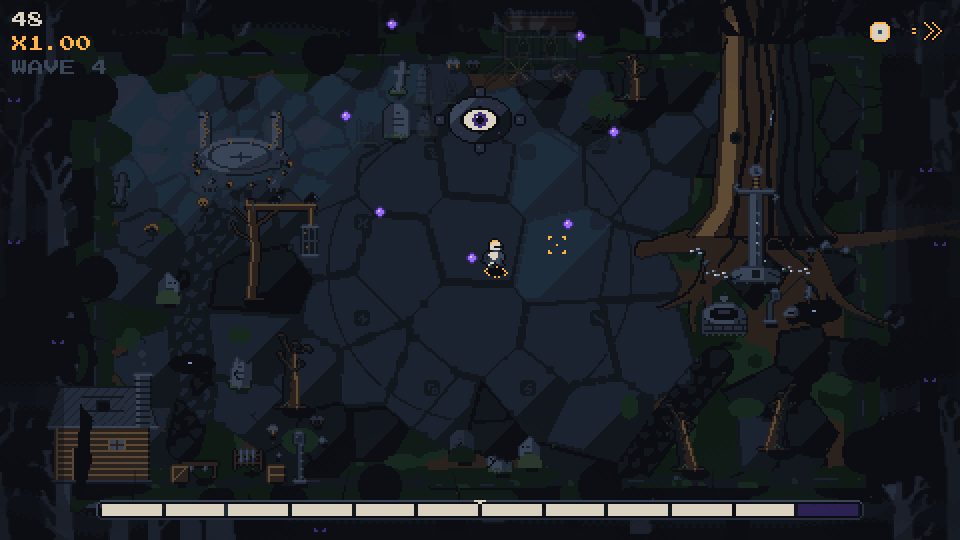
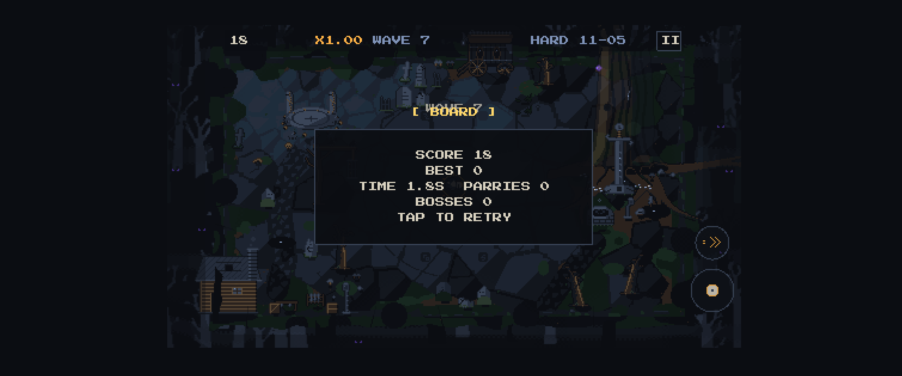

# Nightgrave

A dark-fantasy, single-arena dodge-and-parry survival game for the browser. Endless waves, one hit and the run is
over, instant restart, a score chase. Parry the violet threats, dodge or dash through the red ones. Two heroes play
differently: the Knight parries with a shield arc where it moves and banks a guard, the Wisp parries all around and
its dash burns shots. Two bosses (Eye
Sentinel, Lich Mage), two pickups, three difficulties and an online daily board for Hard, where every score is
verified by re-simulating its replay. Static HTML5 (TypeScript, Phaser 3, Vite); the title lives in one constant,
`TITLE` in `src/config.ts`.

**Play:** [nightgrave.com][play] (the same game is also reachable at nightgrave.pages.dev). On a phone, "Add to Home Screen" (Safari: Share -> Add to Home Screen;
Chrome: menu -> Add to Home screen / Install app) opens the game fullscreen without the browser bars.

| | |
| --- | --- |
|  |  |
|  |  |

More: [Lich Mage](docs/screenshots/boss_lich.png), [phone in portrait](docs/screenshots/phone_portrait.png),
[the phone-portrait console shell](docs/screenshots/shell.png),
[phone board](docs/screenshots/phone_board.png),
[multiplier label](docs/screenshots/multiplier_hud.png), [Double Score](docs/screenshots/double_score.png),
[heroes: Knight shield arc and Wisp ember trail](docs/screenshots/heroes.png).

## Controls

| Device | Move | Parry | Dash | Pause |
| --- | --- | --- | --- | --- |
| Mouse | the hero follows the cursor | left click | right click | Esc or P |
| Keyboard | WASD / arrows | J or Z | K, Shift or Space | Esc or P |
| Gamepad | left stick | A | B or RT | Start |
| Touch | the fixed joystick (Stick, default), or drag anywhere (Drag, in Settings) | PARRY button (Drag: also a second-finger tap) | DASH button | pause button |

On phones, landscape shows the whole arena; portrait plays with a zoomed camera and edge markers for threats outside
the view, inside an original "relic console" shell (riveted screen bezel, stick well, PARRY / DASH caps, status lamps). "Left-handed" in Settings mirrors the joystick and the touch buttons.

## Run it

```bash
npm install
npm run dev          # http://localhost:5173
npm test             # Vitest (sim, bosses, storage, touch, audio logic, shared code, Worker)
npm run build        # production build in dist/
npm run assets       # regenerate all art (Python 3 + Pillow + numpy) and run the art checks
npm run audio:check  # which audio files are present / missing
npm run smoke        # Playwright smoke test on a production build (phone + desktop)
npm run bot          # balance report per hero (skilled and dodge-only bots per difficulty)
```

Audio: put mp3 files in `assets/audio/` with the exact names from [docs/AUDIO_LIST.md](docs/AUDIO_LIST.md), then run
`npm run audio:check`. Missing files fall back to synthesized sounds. Without `VITE_API_BASE` the game runs fully
offline.

## Project layout

| Folder | Purpose |
| --- | --- |
| `src/sim/` | pure deterministic simulation (60 Hz fixed step, seeded PRNG, replay = seed + difficulty + inputs) |
| `src/render/` | Phaser scenes, menus, input (mouse / keyboard / gamepad / touch), audio; they only read sim state |
| `src/shared/` | pure code used by both the game and the server (daily seed, score bound, text rules, replay codec) |
| `src/web/`, `src/net/` | the page around the canvas (layout, board panel) and the board API client |
| `src/data/` | tuning and game data |
| `server/` | Cloudflare Worker + D1 for the Hard daily board (`server/migrations/`, `server/wrangler.toml`) |
| `tools/` | deterministic Python art pipeline and checks; `tools/verify/` is the replay verifier, `tools/bot/` the balance bots |
| `assets/` | generated art (sprites, atlas, backgrounds, data), committed so the site build needs no Python; `assets/audio/` takes the mp3 files (none yet: synthesized fallback) |
| `public/` | static files served as-is (font, icons, manifest, `og-image.png`, `_headers`) |
| `tests/`, `tests-e2e/` | Vitest suites and Playwright scripts |
| `docs/` | deploy guide, art and audio specs, README screenshots |

The root also holds `index.html` and the four player-facing pages (`privacy.html`, `rules.html`, `credits.html`,
`license.html`), built by Vite as separate pages.

## Documentation

- [docs/DEPLOY.md](docs/DEPLOY.md) - Cloudflare Pages + Worker + D1, step by step, and the site constants.
- [docs/RUNBOOK.md](docs/RUNBOOK.md) - operations: kill switch, rollback, moderation, secrets, backups, monitoring.
- [docs/ASSETS_SPEC.md](docs/ASSETS_SPEC.md) - art direction, palette and the full asset list.
- [docs/AUDIO_LIST.md](docs/AUDIO_LIST.md) - every sound and music file with its generation prompt.
- [CLAUDE.md](CLAUDE.md) - the design and the architecture rules.
- [SECURITY.md](SECURITY.md) - how to report a vulnerability.

## Privacy

No accounts, no cookies, no analytics, no ads. Only when a Hard run is submitted to the daily board, the server stores
the name, a short message (for the day's best run), the score, the hero, the run length, the view (full arena or the
zoomed phone camera), the replay, a random player id from the browser and the date. Rate-limit counters use a salted
hash of the IP address (never the address) and are deleted within two days; board entries are kept 30 days; a small
operations log (moderation actions, verification results, hourly counts of failed private-endpoint access) holds no
names, messages, player ids or IPs, only entry numbers (pointing to an entry while it exists), and is kept 90 days. Deletion requests: see the contact on [privacy.html](privacy.html) (until a project
mailbox exists, the private report form described in [SECURITY.md](SECURITY.md)); the maintainers remove entries with
the admin endpoint ([docs/RUNBOOK.md](docs/RUNBOOK.md)).

## How scores are verified

Only runs proven by re-simulation appear on the Hard daily board. The game sends the score together with its input log
(compressed). The Worker checks plausibility and keeps the run as **pending**. Every 20 minutes a GitHub Action
(`npm run verify:pending`) re-runs the same deterministic simulation from the seed and the inputs and compares the
length and the score exactly; only a match is promoted to the board. A 10-minute run verifies in well under a second.

Remaining risks: a verified run can still come from an automated player (a bot that plays the real game); the daily
seed is a public hash of the date, so the next day's layout can be practised early. Proposed later fix: mix a server
secret into the seed and publish it at 00:00 UTC (offline Hard runs would then be unranked).

## License

- Code: [MIT](LICENSE), copyright (c) 2026 The Nightgrave Authors.
- Art and audio: all rights reserved, see [assets/LICENSE.md](assets/LICENSE.md). Audio made with ElevenLabs also
  follows the ElevenLabs terms.
- Font: Press Start 2P by CodeMan38 (and the `px8` bitmap font made from it) stays under the SIL Open Font License 1.1.
- Engine: Phaser 3 (MIT).
- Credits: art and code were generated for this project; audio credits come with the audio files
  (`credits.html` in the game).

[play]: https://nightgrave.com
